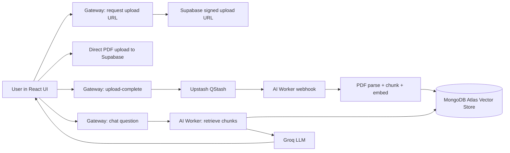

# OmniQuery AI

OmniQuery is an end-to-end asynchronous RAG platform for chatting with uploaded documents.

If you upload a large PDF, the app does not block your API request. Instead, it queues document processing in the background and keeps the user experience fast.

This repository is built to be free-tier friendly and deployable as a real product foundation.

## What This Project Is

OmniQuery solves this problem:

- Users upload long documents.
- You need chunking, embeddings, and vector indexing.
- That work is slow and should not happen inside the web request lifecycle.

So the system is split into three services:

- Frontend: React app for upload + chat UX.
- Gateway: Express API for signed uploads, queue trigger, and chat proxy.
- AI Worker: FastAPI service for async processing + RAG answer generation.

## What Is RAG (Simple Explanation)

RAG means Retrieval-Augmented Generation.

Without RAG:

- LLM answers from its pretraining memory.
- It can hallucinate.

With RAG:

- System retrieves relevant chunks from your own docs.
- LLM answers using that context.
- You can show sources/snippets for trust.

In OmniQuery:

- PDFs are parsed and chunked.
- Chunks are embedded and stored in MongoDB Atlas Vector Search.
- At question time, top matching chunks are retrieved.
- Prompt sent to Groq includes retrieved context.
- UI displays answer + source snippets.

## System Design



## Why This Architecture

- Fast API responses: upload-complete returns immediately.
- Better reliability: queue absorbs spikes.
- Better UX: user is not waiting for indexing.
- Better scale path: worker can be scaled independently.

## Monorepo Structure

```text
main-project/
├── .github/
│   └── workflows/
│       └── ci-cd.yml
├── frontend/
│   ├── src/
│   │   ├── api/
│   │   ├── components/
│   │   ├── layouts/
│   │   ├── pages/
│   │   ├── App.jsx
│   │   └── main.jsx
│   ├── package.json
│   └── tailwind.config.js
├── gateway/
│   ├── src/
│   │   ├── middlewares/
│   │   ├── routes/
│   │   ├── services/
│   │   ├── utils/
│   │   └── server.js
│   ├── Dockerfile
│   └── package.json
├── ai-worker/
│   ├── app/
│   │   ├── api/
│   │   ├── core/
│   │   ├── rag/
│   │   ├── services/
│   │   └── main.py
│   ├── Dockerfile
│   └── requirements.txt
└── README.md
```

## Technology Stack

- Frontend: React, Vite, Tailwind CSS, Lucide icons
- Gateway: Node.js, Express, Supabase SDK, Upstash QStash
- AI Worker: FastAPI, LangChain, HuggingFace embeddings, Groq SDK
- Data: Supabase Storage, MongoDB Atlas Vector Search
- CI/CD: GitHub Actions
- Deployment: Vercel + Render + Koyeb (or Render alternatives)

## End-to-End Data Flow

### 1) Document Ingestion

1. Frontend asks Gateway for signed upload URL.
2. Gateway creates signed upload token from Supabase.
3. Frontend uploads PDF directly to Supabase Storage.
4. Frontend tells Gateway that upload finished.
5. Gateway publishes event to QStash.
6. QStash calls AI Worker webhook.
7. AI Worker verifies QStash signature.
8. AI Worker downloads PDF, chunks text, creates embeddings.
9. Chunks and vectors are saved in MongoDB Atlas with tenant metadata.

### 2) Chat Retrieval + Generation

1. Frontend sends user query to Gateway.
2. Gateway forwards query to AI Worker.
3. AI Worker runs vector similarity search with tenant filter.
4. Top chunks are sent as context to Groq model.
5. Response + source snippets return to frontend.

## Is It Real-World Ready?

Short answer: yes as a strong production starter, not yet final enterprise-grade.

### Already Real-World Patterns

- Async queue between web and AI worker.
- Signed upload URL (browser never sees service role secret).
- Webhook signature verification.
- Tenant metadata filtering for retrieval.
- Service separation for independent scaling/deployments.

### Still Needed Before High-Scale Enterprise

- Real auth/JWT (replace demo user headers).
- Persistent job tracking states in DB.
- Retry policies, dead-letter queue, idempotency keys.
- Full observability (metrics, traces, alerts, dashboards).
- Integration and load tests.
- Rate limiting, WAF rules, secret rotation policy.

## Scalability Guide

### What scales first

- AI Worker CPU/RAM usage during embedding.
- MongoDB vector index size and query latency.
- Queue backlog during peak upload spikes.

### How to scale docs processing

- Run multiple AI Worker replicas behind the same webhook endpoint.
- Use queue-based backpressure and monitor lag.
- Batch chunk inserts to Mongo efficiently.
- Add max upload size and page count limits per plan.
- Store processing status in DB and render real status in UI.

### How to scale chat

- Cache frequent retrieval results.
- Tune topK and chunk size for latency vs quality.
- Use smaller/faster models for low-priority requests.
- Add streaming responses to improve perceived latency.

## Free-Tier Deployment Plan

### Services

- Frontend: Vercel hobby
- Gateway: Render free web service
- AI Worker: Koyeb free service (or equivalent)
- Storage: Supabase free project
- Queue: Upstash free QStash
- Vector DB: MongoDB Atlas M0
- LLM: Groq free API tier

### Deploy Steps

1. Push this repo to GitHub.
2. Create all free accounts above.
3. Set environment variables in each platform from .env.example files.
4. Deploy frontend with root directory frontend.
5. Deploy gateway with root directory gateway.
6. Deploy ai-worker with root directory ai-worker using Dockerfile.
7. Set QStash destination URL to ai-worker webhook endpoint.
8. Put QStash signing keys into ai-worker environment.
9. Create MongoDB vector index named vector_index (or match your env var).
10. Run an end-to-end upload and chat test.

## Local Development Setup

### Prerequisites

- Node.js 20+
- Python 3.11 (64-bit recommended)
- pip

### 1) Install dependencies

```bash
cd gateway
npm install

cd ../frontend
npm install

cd ../ai-worker
py -m pip install -r requirements.txt
```

### 2) Configure environment files

- Copy gateway/.env.example to gateway/.env
- Copy frontend/.env.example to frontend/.env
- Copy ai-worker/.env.example to ai-worker/.env

### 3) Run services in separate terminals

```bash
cd gateway
npm run dev
```

```bash
cd ai-worker
py -m uvicorn app.main:app --reload --port 8000
```

```bash
cd frontend
npm run dev
```

### 4) Open app

- http://localhost:5173

## CI/CD

GitHub Actions workflow in .github/workflows/ci-cd.yml does:

- Gateway dependency install and smoke checks
- AI Worker dependency install and import checks
- Deployment gate after checks pass on main branch

## Security Notes

- QStash webhook signature validation is mandatory.
- Keep Supabase service role keys server-side only.
- Enforce tenant filters in retrieval queries.
- Add auth and RBAC before multi-user production.

## Competitors and Positioning

### Direct/Platform Competitors

- OpenAI Assistants + file search
- Azure AI Search + OpenAI
- AWS Bedrock Knowledge Bases
- GCP Vertex AI Search and Conversation
- Pinecone + custom app stack

### Open Source Competitors

- Haystack
- LlamaIndex starter stacks
- Dify
- Flowise

### OmniQuery Position

- Pros: low cost, transparent architecture, full control, easy custom logic.
- Cons: more DevOps and integration effort than managed all-in-one platforms.

## Cost Reality (No-Nonsense)

- Yes, you can build and launch on free tiers.
- No, free tiers are not infinite for production scale.
- Expect to pay later when usage grows (especially compute, DB, model tokens).

## Roadmap to Production Maturity

1. Add authentication and tenant isolation from JWT claims.
2. Add document/job collections and lifecycle states.
3. Add retries, DLQ, and idempotent processing keys.
4. Add observability stack and SLOs.
5. Add integration tests and load testing.
6. Add autoscaling rules and cost guardrails.

## FAQ

### Is this architecture overkill for small apps?

For very small apps, yes. For document-heavy AI apps, this async split becomes necessary quickly.

### Can this run fully on one server first?

Yes, but keep the queue and worker separation in code so migration to scale is easy.

### Can I replace MongoDB Atlas vector search?

Yes, you can swap to pgvector, Qdrant, Weaviate, or Pinecone by changing vector store adapters.

## Important Disclaimer

This repo is an engineering blueprint and working starter implementation. It is not yet a compliance-certified enterprise platform out of the box.

## Windows Note (py Launcher)

Use the py launcher for all Python commands on Windows.

- Install Python 3.11 (64-bit) and ensure it is available as py -3.11.
- This project may fail on Python 3.14 due to dependency wheel/build compatibility.
- Recommended commands:
	- py -3.11 -m pip install -r requirements.txt
	- py -3.11 -m uvicorn app.main:app --reload --port 8000
